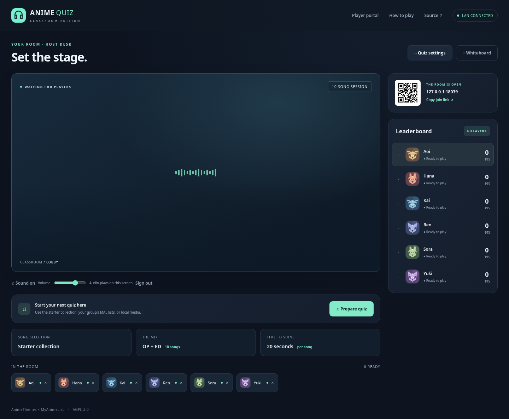

# AMQ-Classroom

An AMQ-inspired, local-network edition of [przemub/anime_quiz](https://github.com/przemub/anime_quiz). One classroom screen plays the music and reveals the video. Everyone else joins on a phone or laptop, guesses the anime, and gets scored automatically.

**Host:** `http://localhost:8009/host` · **Players:** `http://YOUR-LAN-IP:8009`



## Start a classroom

Install **Python 3.12 or newer**, clone this fork, and run:

```sh
git clone https://github.com/SimplePotat/anime-quiz-classroom.git
cd anime-quiz-classroom
./start-classroom.sh
```

On Windows, run **`start-classroom.cmd`** instead. The launcher creates a virtual environment and installs the four classroom dependencies on its first run. No Node, Redis, cloud account, or MAL API key is needed to run the app.

Or set it up manually:

```sh
python3 -m venv .venv
.venv/bin/python -m pip install --upgrade 'pip>=26.2,<27'
.venv/bin/python -m pip install -r requirements-classroom.txt
.venv/bin/python run_classroom.py
```

Keep the terminal open. It prints the **player URL** and a private **host key**. The key persists across restarts. Open `/host`, enter that key, and connect the computer to the classroom display and speakers.

1. Everyone connects to the same LAN/Wi-Fi and opens the printed player URL or scans the QR code.
2. Players create a name and a passcode. They can save a MAL username and an avatar, then mark themselves ready.
3. The host chooses **Quiz settings → song source**, prepares the quiz, and presses **Start quiz**.
4. Music plays only on the host screen. If the browser requests permission, click **Enable / resume audio**. The timer starts after playback begins.
5. Players submit an anime title. They can revise it until the server closes the round. One correct answer earns one point, regardless of speed.
6. The video and answer appear, scores update, and the host can review answers before continuing. **Whiteboard** opens a larger, fullscreen-friendly display.

Use **Results CSV** at the end to save standings and round-by-round answers. **Play again** keeps the group and their profiles.

### Network address

The server binds to `0.0.0.0:8009`. Its IP detection chooses the active interface. Override it if you have a VPN or multiple network adapters:

```sh
./start-classroom.sh --port 8009 --advertise http://192.168.1.50:8009
```

Replace that example with the host computer's actual LAN address. Allow inbound TCP on the chosen port in the host firewall. School guest networks sometimes block device-to-device traffic; use a network that allows clients to reach the host. No router port forwarding is required. `localhost` works only on the host computer.

By default, HTTP requests must use a literal IP address or `localhost`. To use a named address, explicitly list it in `CLASSROOM_ALLOWED_HOSTS` (without a scheme or port). For example, `CLASSROOM_ALLOWED_HOSTS='*,classroom.school.test'` permits that name plus literal IPs/localhost. The `*` enables IP access; it does not permit arbitrary domain names. This prevents a website from using DNS rebinding to reach the classroom server.

## Included functionality

| Area | Classroom edition |
| --- | --- |
| Profiles | Persistent player names, hashed passcodes, MAL usernames, and eight avatar styles; returning sign-in on another device |
| Multiplayer | Shared room, ready status, presence, late-join spectators, reconnects, up to 100 roster entries |
| Song pools | Starter collection, union of participating players' public MAL lists, or a local media catalog |
| Settings | 1–100 songs, OP/ED selection, MAL statuses, 5–90 second guesses, 5–60 second reveals, independent NSFW/spoiler filters, random clip starts, optional automatic advance |
| Guessing | Title autocomplete, alternative English/romaji/Japanese names where available, case/accent/punctuation normalization, revisions until the deadline |
| Scoring | Server-controlled deadlines, one point per correct anime, tied ranks, private guesses before reveal, host corrections, no-score skips |
| Host display | Audio-only guessing, video reveal, live leaderboard, QR join link, volume, pause/resume, whiteboard mode |
| Recovery | Saved submitted answers on refresh; interrupted games pause on server restart; unfinished preparation can be retried |
| Results | Persistent current game and completed-game records; CSV export of the current game |

This implements the core AMQ-style quiz loop for a classroom. It does not recreate AMQ's account service, ranked matchmaking, chat, avatar economy, dungeon modes, or insert-song catalog. It is an independent project, not affiliated with Anime Music Quiz.

## Song sources

### Starter collection

The included catalog contains verified AnimeThemes metadata for 12 familiar series. It includes openings and endings, alternative titles, and stream URLs. **It does not bundle copyrighted music or video.** The host needs internet to stream those videos; player devices only talk to the local server.

Quiz settings has independent **Filter NSFW videos** and **Filter videos tagged with spoilers** toggles. Both filters are enabled by default and use AnimeThemes' [NSFW and spoiler flags on theme entries](https://github.com/AnimeThemes/animethemes-api-docs/blob/main/docs/jsonapi/reference/content/animethemeentry/show/index.md). A tagged version is excluded before the video is selected; an untagged version of the same theme can still play. Turning off a filter permits versions carrying that tag. These filters apply to both openings and endings in Starter and Group MAL pools, including cached metadata. The previous spoiler preference is preserved when upgrading.

### Group MAL lists

Players save their **username**, never their MAL password. Choose **Group's MAL lists** in quiz settings. Lists must be public. Watching and Completed are selected by default; On hold, Dropped, and Plan to watch are optional.

The server combines the selected lists, samples up to 80 anime in randomized order, and looks up their themes on AnimeThemes. It stops when there are enough candidates for the requested quiz. MAL responses are cached for seven days and AnimeThemes metadata for 30 days.

### Fully local / offline music

Use media you are allowed to play. Add files to **`data/media/`** and create **`data/catalog.json`**, following [examples/catalog.json](examples/catalog.json):

```json
[
  {
    "anime": "Cowboy Bebop",
    "aliases": ["Bebop"],
    "song": "Tank!",
    "artist": "Seatbelts",
    "type": "OP",
    "year": 1998,
    "media": "cowboy-bebop-opening.webm"
  }
]
```

The example refers to a file you supply; none is included. The `media` path is relative to `data/media/`. Supported extensions are `.webm`, `.mp4`, `.mp3`, `.wav`, `.ogg`, and `.m4a`; the browser must support the file's codec. H.264/AAC MP4 is a practical choice for cross-browser video compatibility. Local playback supports byte ranges for seeking. Audio-only files work too, with song details shown at reveal.

Choose **Local catalog** in quiz settings. After installing dependencies, local mode needs no internet. Browser scripts, styling, artwork, icons, and QR generation are all served locally. AnimeThemes tag filters are disabled for local files; choose the content of your local collection directly. Your filter preferences are retained when switching sources.

## Docker

```sh
CLASSROOM_JOIN_URL=http://192.168.1.50:8009 \
  docker compose -f compose.classroom.yml up --build -d
docker compose -f compose.classroom.yml logs classroom
```

Set `CLASSROOM_JOIN_URL` to the host computer's LAN address so QR codes do not point at Docker's internal network or localhost. The named volume `classroom_data` preserves profiles, the host key, cache, results, and local media. The container runs as a non-root user. The Docker path is provided separately from the upstream deployment.

## Data and operation

Runtime data lives in **`data/`**, which is excluded from Git and source archives:

- `classroom.sqlite3`: profiles, Django sessions, current game, completed results, and API cache.
- `.host-key`: the host credential, also printed at startup.
- `.django-key`: persistent session signing secret.
- `catalog.json` and `media/`: your optional local collection.

Back up this directory with the server stopped. To move the classroom to another computer, copy it alongside the source. Do not share this directory with players. The UI exposes a Source link to this AGPL-licensed fork.

On POSIX systems, startup restricts the data directory to its owner (`0700`) and secrets/database files to `0600`, including existing installations. Windows deployments rely on the folder's Windows access permissions. Anonymous visitors receive no roster or game details; signed-in players can see their own MAL username but not other players' MAL links.

| Environment variable | Purpose |
| --- | --- |
| `CLASSROOM_DATA_DIR` | Store runtime data somewhere other than `./data` |
| `CLASSROOM_HOST_KEY` | Supply your own host credential instead of the generated key |
| `CLASSROOM_SECRET_KEY` | Override the generated Django secret |
| `CLASSROOM_ALLOWED_HOSTS` | Optional comma-separated HTTP host allowlist; LAN IP access is accepted by default |
| `CLASSROOM_SOURCE_URL` | Link to your own modified source when distributing another variant |
| `CLASSROOM_PREWARM` | Set to `0` to disable background MAL/theme cache warming (enabled by default) |

MAL lists are cached for seven days. AnimeThemes lookups use its [documented resource filters](https://github.com/AnimeThemes/animethemes-api-docs/blob/main/docs/jsonapi/intro/jsonapi/index.md#has-filter) to match exact MAL IDs in batches of ten, with pagination and [pooled HTTP connections](https://requests.readthedocs.io/en/stable/user/advanced/#session-objects) per worker. Successful theme lookups are cached for 30 days; confirmed missing IDs for one day. Existing successful cache entries remain usable. Failed or incomplete responses are not cached as missing anime.

Saving a MAL username or joining/marking ready in the lobby queues optional cache warming. One background worker serves at most 100 pending profiles, coalesces repeated edits, and applies a five-minute cooldown per profile and MAL username. Each job warms at most 40 anime, makes at most eight metadata requests, and stops starting work after 60 seconds. Warming skips local mode and yields when quiz preparation or gameplay starts; an already-running request can finish. It downloads metadata, not music or video, and never changes the quiz or leaderboard. Preparations still choose candidates randomly, so a large list or short lobby wait can leave cache misses.

AnimeThemes [documents a limit of 90 requests per minute](https://github.com/AnimeThemes/animethemes-api-docs/blob/main/docs/jsonapi/intro/ratelimiting/index.md). All metadata work shares provider pacing (at most one request per second, or one every two seconds for background work) and honors `Retry-After` on rate limiting. The providers' quotas may also be used by other clients on the same public IP. Batching reduces request counts substantially, but fixed speedup or cache-hit percentages depend on the lists, pagination, network, and cache contents.

Run **one server process per data directory**. The threaded Waitress server serializes room transitions and persists them atomically in SQLite. The browser polls once a second; countdowns interpolate from server time. This is designed for a trusted classroom LAN over HTTP, not as a public internet service. Host actions require a host session; player mutations require a signed-in profile, and all state-changing requests use Django CSRF protection.

Player sessions last up to 90 days. Host authorization expires after 12 hours and is invalidated when the host key changes and the server restarts with the new key. Signing in as a player removes host authorization from that browser session, and signing in as host removes the player identity. Use a separate browser profile/device if the host also wants to play. Signing out rotates the session and CSRF tokens; unsent drafts are cleared when the player identity changes.

HTTP does not encrypt passcodes or session cookies in transit. Use classroom-specific passcodes and a trusted network. A host key is a privileged credential; keep it off the projected terminal. This edition does not provide TLS termination, public registration moderation, or distributed denial-of-service protection.

Only one host display should play audio. The host should keep its tab active. New players joining during a game spectate until the next game. There is no automatic account recovery; keep player passcodes somewhere the players can remember. Registered names and passcodes belong to this local server, not to MAL.

The roster supports 100 entries. Automated verification covers six browser participants and concurrent state updates, not a 100-device classroom load test.

## Development and verification

Server tests need no external services or music downloads:

```sh
DJANGO_SETTINGS_MODULE=classroom.settings .venv/bin/python -m django test classroom
```

Optional browser tests require Node 24+:

```sh
npm ci
npx playwright install chromium --only-shell
npm run test:browser
node scripts/test_legacy_browser.mjs
```

Set `PYTHON` if the Python executable is not `.venv/bin/python` (or `.venv\Scripts\python.exe` on Windows). The browser suite starts an isolated server, generates synthetic test audio, registers six profiles, uses separate host/phone/desktop sessions, verifies audio, whiteboard mode, answer privacy, scoring, pause/resume, reconnects, CSV and reusable profiles, and writes screenshots into `test-results/`. If FFmpeg is installed, it also generates a video test pattern and verifies video decoding and reveal. CI includes FFmpeg. It removes its temporary database afterwards. No real music or user data is part of these tests.

The included GitHub Actions workflow runs server checks on Python 3.12/3.13, both browser suites on Chromium, and Python/npm dependency audits. The upstream deployment workflows are restricted to the upstream repository so this fork does not attempt to publish to the original author's servers.

## Upstream and license

Forked from [przemub/anime_quiz](https://github.com/przemub/anime_quiz), based on commit `d087636`. The original Django app, templates, assets, and deployment files remain available; its instructions are preserved in [README.upstream.md](README.upstream.md). The classroom edition has independent Django settings and URLs and does not require changes to the original Redis-backed setup.

The retained upstream app also receives security fixes. Its development settings now require `QUIZ_DEBUG=1` to enable debug mode, accept only localhost by default (override with `QUIZ_ALLOWED_HOSTS`), and generate a temporary signing secret unless `QUIZ_SECRET_KEY` is supplied. Set a persistent secret for any multi-process or persistent legacy deployment. Old legacy scoreboard HTML in browser storage is discarded; new scoreboards use JSON. These settings and scoreboard changes do not affect the classroom app.

**AGPL-3.0-or-later**, see [COPYING](COPYING). Original attribution is preserved. Classroom artwork and icons are original SVG assets. Song metadata and stream links come from [AnimeThemes](https://animethemes.moe); anime lists come from [MyAnimeList](https://myanimelist.net). Media remains hosted by its providers or supplied by the host.
