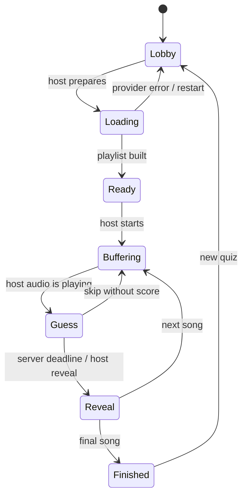

# Classroom implementation

`classroom` is a separate Django application inside the upstream fork. `run_classroom.py` selects `classroom.settings`, applies migrations, recovers interrupted state, discovers the LAN URL, and starts one Waitress process with 16 threads. The original `manage.py`, `quiz`, and `anime_quiz` application remain unchanged.

## Components

- `models.py`: durable profiles, one room document, API caches, and completed game records.
- `engine.py`: authoritative transitions, normalization, scores, deadlines, and public serialization.
- `library.py`: bounded background playlist preparation, MAL pagination, AnimeThemes lookup, caches, local catalog validation.
- `views.py`: session authentication, CSRF-protected JSON endpoints, host authorization, range-capable media, QR and CSV generation.
- `static/app.js`: one-second polling, persistent video element, phone answer forms, countdown interpolation and reconnection.
- `static/style.css` and `scene.svg`: responsive layouts, whiteboard mode and original artwork. No external frontend dependencies.

Skipping a final song also finishes the game. Pause freezes either timed phase. Reset cancels a playlist job through its generation identifier. A restarted timed phase is paused before any expired deadline can advance.

## Integrity boundaries

Each read or mutation of room state holds a process-wide reentrant lock and an immediate SQLite transaction. The server ticks its clock before validating actions. State and score changes commit together; duplicate reveal/next requests cannot reapply points. Concurrent finalization has a multi-threaded test. Multiple server processes require replacing this coordination model and are deliberately unsupported here.

Guests and players receive public room information, broad title suggestions, and the authenticated player's own guess. They receive neither current-song metadata nor the media URL before reveal. Only an authenticated host can load the current media endpoint. Round identifiers reject stale guesses and stale playback confirmations. Title suggestions do not identify the current song.

The host is trusted: it controls playback and may correct answers. The game does not hide answers from the host or attempt to prevent recognition using outside tools. Local media paths must resolve inside the media directory, including after symlink resolution. Range requests are bounded to file size. Profile strings are HTML-escaped. Authentication uses Django hashing and session rotation. CSV formula-like cells are escaped.

## Persistence and tradeoffs

SQLite records survive restarts; ninety-day browser sessions and passcodes allow profile reuse. Browser-only unsent drafts survive pause and temporary connection loss. Only acknowledged guesses survive a page refresh. Loading jobs run in a daemon thread and are restartable, not durable background workers.

Public MAL list scraping and AnimeThemes availability are external dependencies for online mode. Provider failures remain visible. Offline mode removes those dependencies. Metadata caches expire after seven/thirty days. The starter refresh script is a maintainer operation, not required at startup.

There is one classroom per server. Multiple classes can use different ports and data directories. There is no public matchmaking, messaging, email recovery, or cloud service dependency.
